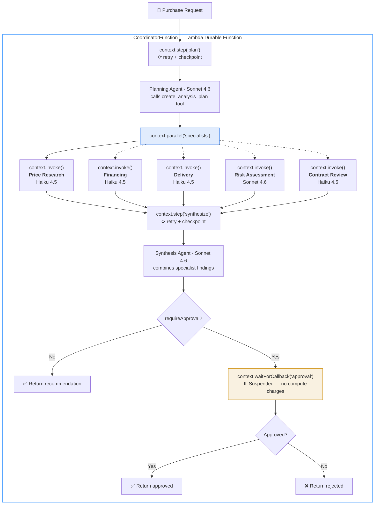

# Multi-Agent Purchasing Coordinator — Lambda Durable Functions

A multi-agent purchasing coordinator that combines [AWS Lambda Durable Functions](https://docs.aws.amazon.com/lambda/latest/dg/durable-functions.html) with [Strands Agents SDK](https://github.com/strands-agents/sdk-js). A coordinator agent orchestrates 5 specialist agents, each deployed as a separate Lambda function. This demo is a continuation of two blog posts:

- [Building Long-Running Workflows with AWS Lambda Durable Functions](https://dev.to/gunnargrosch/aws-lambda-durable-functions-building-long-running-workflows-in-code-1ad3) — durable execution primitives
- [Building Multi-Agent Systems with RISEN Prompts and Strands Agents](https://dev.to/gunnargrosch/building-multi-agent-systems-with-risen-prompts-and-strands-agents-52bd) — multi-agent orchestration

Built on standard Lambda functions — no Docker or container registry required.

## How it works

Submit a purchase request as a JSON event. The coordinator analyzes it with a planning agent, consults specialist agents in parallel, synthesizes findings, and optionally suspends for human approval. The entire workflow runs in a single durable function for up to 24 hours.



> **Solid arrows** = always called &nbsp;|&nbsp; **Dashed arrows** = conditional (selected by planning agent based on purchase details)
>
> Each `context.invoke()` is an independent Lambda function with its own checkpoint. The coordinator suspends while specialists execute — no compute charges during the wait.

```
[CoordinatorFunction] — Lambda Durable Function
  ├→ context.step('plan')            → Planning agent selects specialists
  ├→ context.parallel('specialists') → Runs selected specialists concurrently:
  │     ├─ context.invoke(PriceResearchFunction)  (Haiku 4.5)   ← always
  │     ├─ context.invoke(FinancingFunction)       (Haiku 4.5)   ← if value > $5K
  │     ├─ context.invoke(DeliveryFunction)        (Haiku 4.5)   ← if physical product
  │     ├─ context.invoke(RiskAssessmentFunction)  (Sonnet 4.6)  ← if value > $10K / used
  │     └─ context.invoke(ContractReviewFunction)  (Haiku 4.5)   ← if subscription/lease
  ├→ context.step('synthesize')      → Synthesis agent combines findings
  └→ context.waitForCallback()       → Human approval (when requireApproval=true)
```

During `waitForCallback` suspensions, the function stops executing and compute charges stop. It resumes exactly where it left off when the callback arrives.

Each specialist is a standard Lambda function (1024MB, 60s) invoked directly by the coordinator via `context.invoke()` — the SDK's built-in durable invocation primitive. No API Gateway, no function URLs, no public endpoints — specialists are only reachable by the coordinator's execution role. All functions run on Graviton (arm64).

### Durable primitives used

| Primitive | Where |
| --- | --- |
| `step()` | Plan and synthesis — checkpointed with retry |
| `invoke()` | Each specialist call — checkpointed, suspends while waiting |
| `parallel()` | Runs selected specialists concurrently, each independently checkpointed |
| `waitForCallback()` | Human approval (24h timeout) |

All logging uses `context.logger` (replay-aware) — log lines are deduplicated automatically so they only appear once in CloudWatch, not on every replay.

## Prerequisites

- An AWS account with Amazon Bedrock access to **Claude Sonnet 4.6** and **Claude Haiku 4.5**
- [AWS SAM CLI](https://docs.aws.amazon.com/serverless-application-model/latest/developerguide/install-sam-cli.html) 1.153.1 or later
- Node.js 24+
- AWS credentials configured (`AWS_PROFILE` or default)

## Getting started

```bash
git clone https://github.com/gunnargrosch/durable-multi-agent-purchasing.git
cd durable-multi-agent-purchasing
npm install
npm run demo
```

## Interactive demo

Run `npm run demo` to start the interactive demo. This opens a menu where you pick a mode (local or cloud), a purchase scenario, and (for cloud mode) your AWS profile and region. You play the purchase approver for high-value scenarios.

Three purchase scenarios show different routing patterns:

| Scenario | Value | Specialists | Approval |
| --- | --- | --- | --- |
| Laptop | $1,500 | Price Research + Delivery | No |
| Used car | $18,000 | All 5 specialists | Yes (`waitForCallback`) |
| SaaS subscription | $200/mo | Price Research + Contract Review | Yes (`waitForCallback`) |

To skip the menu, pass the mode and scenario directly:

```bash
npm run demo:local -- --ticket=laptop
npm run demo:cloud -- --ticket=used-car --profile=my-profile --region=us-east-1
```

`demo:local` uses mocked responses and runs entirely offline. `demo:cloud` invokes the deployed Lambda function with real Bedrock calls. The `DemoCommand` stack output shows the exact cloud command with your function ARN and region.

Cloud mode accepts these additional flags:

| Flag | Description |
| --- | --- |
| `--profile=` | AWS CLI profile to use |
| `--region=` | AWS region (overrides profile/env default) |
| `--function-arn=` | Coordinator function ARN (defaults to stack output) |

## Deploy

```bash
sam build
sam deploy --guided
```

The template defaults to **Claude Sonnet 4.6** for the coordinator and **Claude Haiku 4.5** for specialists. To use different models:

```bash
sam deploy --guided --parameter-overrides \
  CoordinatorModelId=anthropic.claude-sonnet-4-6 \
  SpecialistModelId=anthropic.claude-haiku-4-5-20251001-v1:0 \
  AdvancedSpecialistModelId=anthropic.claude-sonnet-4-6
```

## Direct invocation

You can also invoke the function and send callbacks directly via the AWS CLI. Replace `<function-arn>` with the `CoordinatorFunctionArn` output from your stack (it already includes the `:live` alias qualifier — don't append it again):

```bash
# Start a purchase analysis with human approval required.
# The execution name provides idempotency — invoking twice with the same
# name reuses the existing execution instead of creating a duplicate.
aws lambda invoke \
  --function-name <function-arn> \
  --invocation-type Event \
  --durable-execution-name "purchase-$(date +%s)" \
  --cli-binary-format raw-in-base64-out \
  --payload '{"request":"I want to buy a used 2020 Honda Civic for around $18,000","requireApproval":true}' \
  /dev/null
```

Check execution status:

```bash
aws lambda list-durable-executions-by-function \
  --function-name <function-name>
```

When the function suspends at approval, send the callback:

```bash
aws lambda send-durable-execution-callback-success \
  --callback-id "<callback-id-from-execution-history>" \
  --cli-binary-format raw-in-base64-out \
  --result '{"approved":true,"notes":"Looks good, proceed."}'
```

## Testing

```bash
npm test     # Unit tests (mocked Bedrock, local durable test runner)
npm run lint # ESLint
```

## View logs

```bash
sam logs --stack-name multi-agent-durable --name CoordinatorFunction --tail
sam logs --stack-name multi-agent-durable --name PriceResearchFunction --tail
```

The coordinator uses `context.logger` (replay-aware), so log lines only appear once in CloudWatch even when the handler replays.

## Project structure

```text
src/
  handlers/
    coordinator.ts          # Durable execution workflow — plan, parallel, synthesize, approval
    coordinator.test.ts     # Unit tests with LocalDurableTestRunner
    specialist.ts           # Shared handler for all 5 specialists, selected by PROMPT_NAME
  lib/
    models.ts               # Model configuration — coordinator (Sonnet 4.6) and specialist (Haiku 4.5)
    prompts.ts              # Prompt loader — maps prompt names to RISEN prompt modules
    specialist-tools.ts     # Per-specialist tool registry (e.g. save_price_snapshot)
    logger.ts               # Structured JSON logger for non-durable handlers
prompts/
  coordinator-plan.ts       # RISEN prompt — routing logic in Steps section
  coordinator-synthesis.ts  # RISEN prompt — synthesizes specialist findings
  price-research.ts         # Always-on specialist
  financing.ts              # Conditional specialist
  delivery.ts               # Conditional specialist
  risk-assessment.ts        # Conditional specialist
  contract-review.ts        # Conditional specialist
scripts/
  demo.ts                   # Interactive demo — local (mocked) and cloud (real Lambda)
template.yaml               # SAM template — 6 functions, IAM, Bedrock permissions
```

## Design decisions

**Specialists as separate functions.** The [multi-agent blog post](https://dev.to/gunnargrosch/building-multi-agent-systems-with-risen-prompts-and-strands-agents-52bd) runs specialists as in-process `tool()` calls. This demo deploys each specialist as a separate Lambda function invoked via `context.invoke()`, giving you independent scaling, failure isolation, and per-specialist IAM. The coordinator's planning agent still uses `tool()` to capture structured output (the analysis plan), but the specialist invocations are durable SDK primitives, not Strands tool callbacks.

**Per-agent model selection.** The coordinator and risk-assessment specialist use Sonnet 4.6 (stronger reasoning); other specialists use Haiku 4.5 (faster, cheaper). This matches the [Strands blog post's per-agent model strategy](https://dev.to/gunnargrosch/building-multi-agent-systems-with-risen-prompts-and-strands-agents-52bd). Model IDs are parameterized in the SAM template.

**Routing via planning agent, not hooks.** The multi-agent blog post uses a `RoutingHook` with `BeforeToolCallEvent` for real-time routing visibility. This demo doesn't use that hook because specialists are invoked via `context.invoke()` (Lambda-to-Lambda), not as Strands tool calls — so `BeforeToolCallEvent` doesn't fire for specialist invocations. Instead, routing visibility comes from the checkpointed plan step: the `plan_created` log includes `specialistsCalled` and `specialistsSkipped`, and the routing summary is included in the execution result.

**Specialist tools.** Specialist agents aren't just prompt wrappers — each one can have its own tool surface, scoped to its domain, invisible to the coordinator. Currently, the price-research specialist has a `save_price_snapshot` tool that logs structured price data (in production: DynamoDB or a pricing service). Other specialists are pure reasoning. Tools are added per specialist only when that specialist needs to interact with external systems. See `src/lib/specialist-tools.ts`.

**Graceful degradation.** If a specialist fails, the error is captured as a message and passed to the synthesis agent, which notes the gap in its recommendation. The entire parallel block doesn't fail because one specialist is unavailable.

## Durable functions gotchas

If you're building on this demo, be aware of these hard-won lessons from the [durable functions blog post](https://dev.to/gunnargrosch/aws-lambda-durable-functions-building-long-running-workflows-in-code-1ad3):

- **Determinism rule.** Code outside `context.step()` re-executes on every replay and must produce the same result. Don't use `Date.now()`, `Math.random()`, or `crypto.randomUUID()` outside steps. Module-scope code (like `const model = createModel(...)`) only runs on cold start, not replay — that's safe.
- **256KB checkpoint limit.** Each `step()` result is serialized and stored. Specialist responses could be large if the model is verbose. Monitor response sizes and consider truncating or summarizing before returning from a step.
- **Qualified ARN required.** Durable functions must be invoked with a version or alias (e.g., `:live`), not `$LATEST`. The `AutoPublishAlias: live` in the template handles this, but direct invocations must use the qualified ARN from the `CoordinatorFunctionArn` output.
- **Replay overhead.** On resume, the handler re-executes from the start. Completed steps return instantly (cached), but code between steps runs again. Keep inter-step logic minimal and deterministic.
- **`serdes: defaultSerdes` for callbacks.** `waitForCallback()` defaults to passthrough serialization. Pass `defaultSerdes` for typed JSON payloads — without it, the callback result is returned as a raw string.
- **Parallel branch namespacing.** Steps within `parallel()` branches are namespaced by the branch name. If two branches both have a step named `'save'`, they don't collide in the execution history because the branch name prefixes the step name.
- **Retention vs. execution timeout.** `RetentionPeriodInDays` (how long execution history is kept) must be longer than `ExecutionTimeout` (max wall-clock time). This demo uses 7 days retention with a 24-hour execution timeout. If you extend the execution timeout (e.g., for multi-day approval workflows), increase the retention period accordingly.

## Cost

The main cost is Bedrock token usage, not Lambda compute. Rough estimates per purchase analysis:

| Scenario | Specialists | Bedrock calls | Estimated cost |
| --- | --- | --- | --- |
| Laptop (2 specialists) | 2 | ~4 (plan + 2 specialists + synthesize) | ~$0.02–0.05 |
| Used car (5 specialists) | 5 | ~7 (plan + 5 specialists + synthesize) | ~$0.05–0.15 |

Estimates vary with response length. Lambda compute during a 24-hour `waitForCallback` suspension costs ~$0.0001 — you only pay for the brief active execution periods.

## Production considerations

This is a demo. If you use it as a starting point for production:

- **Dead-letter queue.** Add a DLQ or failure destination to the coordinator so failed executions are visible beyond CloudWatch Logs.
- **Alarms.** Add CloudWatch alarms on the coordinator's `Errors` and `Throttles` metrics.
- **Prompt management.** System prompts are inlined as TypeScript modules. Production systems typically store prompts in S3, Parameter Store, or a prompt management service for versioning without redeployment. For dynamic prompts with durable functions: load the prompt inside a `context.step()` so the prompt text is checkpointed — replays use the same prompt version as the original invocation, even if the prompt was updated between replays.
- **Tests.** The included test suite (`npm test`) covers the 4 durable primitives with mocked external I/O. For integration tests against the deployed stack, use `DurableFunctionCloudTestRunner` from `@aws/durable-execution-sdk-js-testing` — it invokes the real function and retrieves execution history via the Lambda API.
- **Conversation.** The coordinator is currently one-shot. A conversational version would wrap invocation in a message history loop — the RISEN prompts remain unchanged, but the coordinator's Steps section would need instructions for when to ask clarifying questions before routing. Durable functions make this interesting: conversation state survives across replays and suspensions.

## License

MIT
